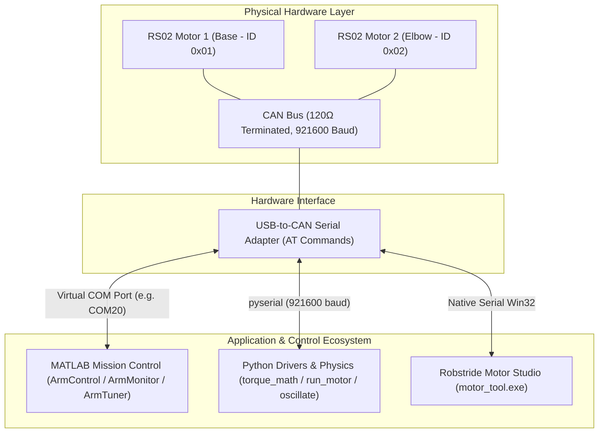

# Robstride 2-DOF Robotic Arm — Project Information & Knowledge Transfer (KT) Document

> **Document Type:** Canonical Knowledge Transfer & Engineering Specification  
> **Status:** Active Production  
> **Governing Convention:** Unified coordinate, kinematic, and dynamics invariants  
> **Target Audience:** Incoming Engineers, Control Systems Specialists, Autonomous Agent Swarms  
> **Primary Workspace:** `C:\Users\vaibh\OneDrive\Documents\Vipul\2-DOF\Robstride-Dev\`  

---

## 1. Executive Summary & Architectural Topology

The **Robstride 2-DOF Robotic Arm** project is a comprehensive robotics engineering platform encompassing real-time motor control, kinematic modeling, dynamic torque and inertia calculation, mission control telemetry streaming, and automated multi-agent software auditing.

The robotic manipulator is a 2-DOF planar articulated arm driven by two **Robstride RS02** brushless smart actuators:
- **Joint 1 (Base / Shoulder):** Operates at CAN ID `0x01` driving the proximal link ($L_1 = 400$ mm).
- **Joint 2 (Elbow / Forearm):** Operates at CAN ID `0x02` driving the distal link ($L_2 = 300$ mm).

### Subsystems Topology



---

## 2. Hardware Specifications & Physical Parameters

### 2.1 Arm Physical Constants

| Parameter | Identifier | Nominal Value | Units | Engineering Description |
| :--- | :--- | :--- | :--- | :--- |
| **Base Link Length** | $L_1$ | `400.0` | mm | Center-to-center distance from base pivot to elbow joint |
| **Fore Link Length** | $L_2$ | `300.0` | mm | Center-to-center distance from elbow joint to Tool Center Point (TCP) |
| **Base Link Mass** | $m_1$ | User Configurable | kg | Uniform mass of the proximal structural link |
| **Fore Link Mass** | $m_2$ | User Configurable | kg | Uniform mass of the distal structural link |
| **Elbow Motor Mass** | $m_m$ | User Configurable | kg | Actuator mass at elbow (modeled as point mass at $L_1$) |
| **Payload Mass** | $m_p$ | User Configurable | kg | External payload concentrated at the TCP end |
| **Gravity Acceleration**| $g$ | `9.81` | $\text{m/s}^2$ | Acts vertically downwards along negative Y axis |
| **Maximum Reach** | $R_{max}$ | `700.0` | mm | Full extension ($L_1 + L_2$) |
| **Minimum Reach** | $R_{min}$ | `100.0` | mm | Fully folded inner singularity ($|L_1 - L_2|$) |

### 2.2 Actuator Specifications (Robstride RS02)

- **Actuator Type:** High-torque brushless DC outrunner with integrated planetary gearbox, 14-bit absolute encoder, and field-oriented controller (FOC).
- **Torque Constant ($K_M$):** `1.22 N·m/A_rms`.
- **Hardware Peak Torque Limit:** `17.0 N·m` (register parameter `0x700B`).
- **Nominal Thermal Current Limit:** `5.0 A` continuous; auto-throttled to `3.0 A` under thermal alarm conditions.
- **Supply Voltage:** `24V - 48V DC` nominal (nominal 5A per motor, 10A recommended power supply rating).
- **Communication Protocol:** CAN 2.0B over serial AT-bridge at **921,600 baud**.
- **Bus Architecture:** Linear bus with $120\,\Omega$ termination resistors installed at both physical cable terminations.

---

## 3. Mathematical Modeling, Kinematics & Analytical Dynamics

### 3.1 Unified Coordinate Frame & Chirality Invariant

To ensure mathematical consistency across MATLAB, Python, and TypeScript, the entire project enforces a single coordinate invariant:

```
                  +Y (Up)
                    ^
                    |
     -X (CCW 90°) <-+-> +X (CW 90°)
                    |
                    v
                  -Y (Gravity Vector, Zero-Position)
```

1. **Gravity Alignment:** The gravity vector acts downwards along $-Y$: $\vec{g} = [0, -9.81]^T\,\text{m/s}^2$.
2. **Zero Position ($\theta_1 = 0^\circ, \theta_2 = 0^\circ$):** Both links point straight downwards along $-Y$. TCP sits at Cartesian coordinate $(0, -700)$ mm.
3. **Chirality (Rotation Direction):**
   - **Positive Angle ($\theta > 0$):** Clockwise (CW) rotation.
   - **Negative Angle ($\theta < 0$):** Counter-Clockwise (CCW) rotation.
4. **Joint References:**
   - $\theta_1$: Absolute shoulder angle measured clockwise from vertical downward.
   - $\theta_2$: Relative elbow angle measured clockwise from the centerline of Link 1.
   - Absolute orientation of Link 2: $\phi_2 = \theta_1 + \theta_2$.

### 3.2 Forward Kinematics (FK)

Given joint angles $\theta_1, \theta_2$ in radians, the forward kinematic map computes the end-effector position $(x, y)$:

$$x = -L_1 \sin(\theta_1) - L_2 \sin(\theta_1 + \theta_2)$$
$$y = -L_1 \cos(\theta_1) - L_2 \cos(\theta_1 + \theta_2)$$

### 3.3 Inverse Kinematics (IK)

Given target coordinates $(x, y)$, the solver calculates joint angles $(\theta_1, \theta_2)$:

1. **Radial Reach Check:**
   $$R = \sqrt{x^2 + y^2}$$
   Valid workspace: $100\,\text{mm} \le R \le 700\,\text{mm}$. If $R > 700\,\text{mm}$ or $R < 100\,\text{mm}$, the solver throws an `OutOfReach` exception.

2. **Elbow Angle ($\theta_2$):**
   $$\cos(\theta_2) = \frac{R^2 - L_1^2 - L_2^2}{2 L_1 L_2}$$
   - **Elbow Up Configuration:** $\theta_2 = +\arccos(\cos(\theta_2))$ (where $\theta_2 > 0$).
   - **Elbow Down Configuration:** $\theta_2 = -\arccos(\cos(\theta_2))$ (where $\theta_2 < 0$).

3. **Base Angle ($\theta_1$):**
   Using auxiliary angles $\beta = \text{atan2}(-x, -y)$ and $\psi = \text{atan2}(L_2 \sin(\theta_2), L_1 + L_2 \cos(\theta_2))$:
   $$\theta_1 = \beta - \psi$$

4. **Phase Normalization:**
   Joint angles are mapped to $[-\pi, \pi]$:
   $$\theta_{norm} = \text{mod}(\theta + \pi, 2\pi) - \pi$$

### 3.4 Multi-Turn Shortest-Path Unwrapping

Because RS02 actuators support multi-turn positioning, commanding an angle across the $\pm\pi$ boundary must not cause a reverse full-circle rotation. The `calculate_shortest_path` algorithm computes the unwrapped continuous target:

$$\Delta\theta = \text{mod}((\theta_{target} - \theta_{current}) + \pi, 2\pi) - \pi$$
$$\theta_{unwrapped} = \theta_{current} + \Delta\theta$$

### 3.5 Analytical Rigid-Body Dynamics & Sizing Equations

Implemented in [`torque_math.py`](file:///c:/Users/vaibh/OneDrive/Documents/Vipul/2-DOF/Robstride-Dev/python/torque_math.py):

#### Horizontal Moment Arms
- Base to Elbow: $dx_1 = -L_1 \sin(\phi_1)$
- Elbow to TCP: $dx_2 = -L_2 \sin(\phi_2)$
- Elbow Center of Mass: $dx_{elbow\_com} = -(L_2 / 2) \sin(\phi_2)$
- Base Center of Mass: $dx_{base\_com} = -(L_1 / 2) \sin(\phi_1)$

#### Continuous Gravitational Holding Torque
$$\tau_{elbow, cont} = g \cdot \left| m_2 \cdot dx_{elbow\_com} + m_p \cdot dx_2 \right|$$
$$\tau_{base, cont} = g \cdot \left| m_1 \cdot dx_{base\_com} + m_m \cdot dx_1 + m_2 \cdot (dx_1 + dx_{elbow\_com}) + m_p \cdot (dx_1 + dx_2) \right|$$

#### Mass Moment of Inertia
$$I_{elbow} = \frac{1}{3} m_2 L_2^2 + m_p L_2^2$$
$$I_{base} = \frac{1}{3} m_1 L_1^2 + m_m L_1^2 + m_2 \left( \frac{1}{3} L_2^2 + L_1^2 + L_1 L_2 \right) + m_p (L_1 + L_2)^2$$

#### Peak Dynamic Torque
$$\tau_{peak} = \tau_{cont} + I \cdot \alpha$$

---

## 4. Subsystems Architecture & Implementation

### 4.1 MATLAB Mission Control Suite (`matlab/`)

Verified on **MATLAB R2026b** (compatible with R2020b+ without external toolboxes).

- **`ArmControl.m` (Controller Layer):**
  - Manages serial-to-CAN communication at 921,600 baud.
  - Generates atomic 34-byte dual-motor packet writes (`set_both_targets(th1, th2)`), eliminating timing skew between joints.
  - Implements motion modes: Position (`0x7005 = 1`), Velocity (`0x7005 = 2`), Current (`0x7005 = 3`), and MIT control mode.
  - Provides trajectory interpolation: Linear Cartesian, Joint Curve, and Arch (+80 mm vertical apex clearance).
  - Background telemetry loop polling at up to 50Hz.

- **`ArmMonitor.m` (Mission Control UI):**
  - Built on `uifigure` using a 5-column balanced CSS-like grid:
    - **Col 1:** Connection, serial port selector, motor enable/homing, fault indicator.
    - **Col 2:** Interactive 2D planar kinematic visualizer and arm pose canvas.
    - **Col 3:** Joint targets, Cartesian XY IK inputs, trajectory speed/acceleration controls.
    - **Col 4:** Real-time dual-motor 6-channel oscilloscope with vertical locked scrolling.
    - **Col 5:** 50-column CSV data logger with manual and timed-duration recording modes.
  - 25Hz UI update timer reading from pre-buffered telemetry without blocking the serial worker.
  - **Thermal Watchdog:** Throttles current if temperatures exceed 55°C; alerts red at >80°C.
  - **3-Layer Scroll Workaround:** Uses `master_grid` $\to$ `scroll_panel` $\to$ `canvas_panel` (fixed 960px height) to bypass MATLAB `uigridlayout` viewport clipping.

- **`ArmTuner.m` (PID Calibration & Step Response):**
  - Commands calibrated step responses and logs 50Hz dynamic feedback.
  - Computes rise time, settling time, overshoot percentage, and steady-state error.
  - Outputs Ziegler-Nichols tuning suggestions.

### 4.2 Python Control Suite & Web Visualizer (`python/`)

- **`torque_math.py`:** Analytical dynamics core calculating continuous and dynamic torques.
- **`oscillate_motors.py`:** Dual-motor sinusoidal oscillation script with automated CAN heartbeat and graceful SIGINT / SIGTERM safety shutdown.
- **`run_motor.py`:** Direct single-motor CLI driver for parameter read/write and position cycling.
- **`python/web/app.py`:** Flask web application serving an SVG arm visualizer with live torque updates.

### 4.3 Robstride Motor Studio (`MotorStudio/`)

- Vendor commissioning suite located at `MotorStudio/motor_toolV14L/motor_tool.exe`.
- Used for low-level motor flashing, zero-point encoder calibration, and register inspection over USB-to-UART.

---

## 5. Operational Runbooks & Procedures

### 5.1 MATLAB Live Hardware Runbook

1. Connect the USB-to-CAN adapter to the host machine.
2. Confirm the active COM port in Windows Device Manager (e.g. `COM20`).
3. In MATLAB, navigate to `matlab/` and execute:
   ```matlab
   run_arm_live
   ```
4. Click **Connect** in Column 1. Observe motor status changing to energized.
5. In Column 3, specify target angles or Cartesian XY coordinates and execute motion.
6. To log telemetry, specify target directory in Column 5, choose duration, and toggle **Start CSV Log**.
7. In case of anomaly, hit **SPACEBAR** to trigger instantaneous hardware E-STOP (Comm Type 0x04).

### 5.2 MATLAB Offline Verification (Zero-Hardware)

To verify UI layouts, PID clamping, and kinematic solvers without physical motors connected:
```matlab
cd('C:\Users\vaibh\OneDrive\Documents\Vipul\2-DOF\Robstride-Dev\matlab');
run_verification
```

### 5.3 Automated Regression Test Suites

Execute all validation suites via PowerShell headless batch:
```powershell
& "C:\Program Files\MATLAB\R2026b\bin\matlab.exe" -batch "cd('C:\Users\vaibh\OneDrive\Documents\Vipul\2-DOF\Robstride-Dev\matlab'); test_shortest_path; test_trajectory_planning; verify_kinematics_comprehensive; test_armmonitor_layout; disp('ALL TESTS PASSED'); quit"
```

---

## 6. Critical Invariants, Safety Systems & Known Traps

| Category | Invariant / Requirement | Mechanism / Workaround |
| :--- | :--- | :--- |
| **Emergency Stop (E-STOP)** | Atomic dual-motor de-energize | Transmits Comm Type `0x04` back-to-back to Motor IDs `0x01` and `0x02` in a single serial write buffer. Spacebar trigger. |
| **Synchronized Motion** | Prevent inter-motor trajectory skew | Uses `set_both_targets(th1, th2)` packing both CAN frames into an atomic 34-byte transmission. |
| **Multi-Turn Wrapping** | Prevent $359^\circ$ reverse turn across $\pm\pi$ | Continuous shortest-path unwrapping via `calculate_shortest_path()`. |
| **Thermal Protection** | Prevent actuator overheating | Software thermal watchdog drops current limit from 5.0A to 3.0A at $>55^\circ\text{C}$; visual red alert at $>80^\circ\text{C}$. |
| **MATLAB UI Scrolling** | `uigridlayout` clipping bug | 3-layer architecture (`master_grid` $\to$ `scroll_panel` $\to$ `canvas_panel` with fixed 960px height). |
| **Ground Reference** | Eliminate CAN communication dropouts | Actuator ground, 24-48V power supply ground, and USB-CAN ground must be physically tied to common reference. |

---

## 7. Verification Matrix & Quality Baselines

| Test File | Subsystem | Scope | Passing Criteria |
| :--- | :--- | :--- | :--- |
| [`verify_kinematics_comprehensive.m`](file:///c:/Users/vaibh/OneDrive/Documents/Vipul/2-DOF/Robstride-Dev/matlab/verify_kinematics_comprehensive.m) | Kinematics Engine | 1500 annular points in all 4 quadrants | FK/IK Euclidean round-trip error $< 10^{-4}$ mm; CW rotation confirmed. |
| [`test_shortest_path.m`](file:///c:/Users/vaibh/OneDrive/Documents/Vipul/2-DOF/Robstride-Dev/matlab/test_shortest_path.m) | Angle Unwrapping | Wrap boundaries ($+\pi \to -\pi/2$, etc.) | Smooth unwrap without phase jumps exceeding $\pi$. |
| [`test_trajectory_planning.m`](file:///c:/Users/vaibh/OneDrive/Documents/Vipul/2-DOF/Robstride-Dev/matlab/test_trajectory_planning.m) | Trajectory Generator | Linear, Joint Curve, Arch profiles | Boundary rejection at $>700$ mm; Arch $+80$ mm apex verified. |
| [`test_armmonitor_layout.m`](file:///c:/Users/vaibh/OneDrive/Documents/Vipul/2-DOF/Robstride-Dev/matlab/test_armmonitor_layout.m) | Mission Control UI | 5-column layout & 25Hz telemetry | Viewport sizing, PID clamping, and 50-column CSV format verified. |
| [`test_torque_math.py`](file:///c:/Users/vaibh/OneDrive/Documents/Vipul/2-DOF/Robstride-Dev/python/test_torque_math.py) | Python Physics | 11 unit tests across poses and payloads | Exact analytical gravity torque and inertia matches. |
| `Cryptographic Parity Audit` | Workspace Sync | 384 tracked repository files | 0 missing files, 0 hash mismatches between dev and upstream git master. |

---

## 8. Multi-Agent Development & Operational Protocol

Autonomous agent teams operating in this workspace follow the **Gatekeeper Protocol** managed via `.agents/`:
- **Task Tracking (`.agents/tasks.md`):** Tasks are recorded with descriptive milestones. No task may be marked as complete without an audit confirmation entry from a verification subagent.
- **Inter-Agent Message Bus (`.agents/comm.md`):** Inter-agent communication follows the standard schema:
  ```markdown
  [FROM: <Agent_Role>] -> [TO: <Agent_Role / ALL>]
  [STATUS: Information / Request / Urgent / Passed / Failed]
  [BODY: Specific technical findings, paths, and results]
  ```
- **Structural Blueprint (`.agents/Workspace_Structure.md`):** Central source of truth for repository layout, maintained by the Coworker agent. All agents re-read this document before making structural workspace changes.
